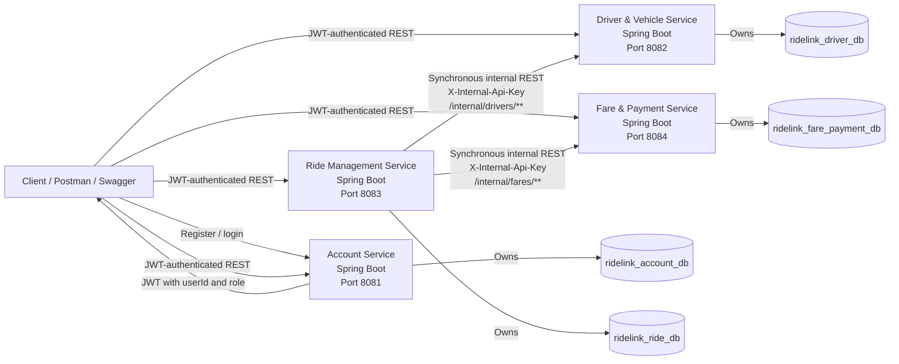

# RideLink Architecture Diagram

RideLink - Backend Microservices for a Ride-Sharing Platform
IT3130 - Application Development
Group G112

## Explanation

RideLink is organized as four independent Java 21 / Spring Boot services. Each service has a separate responsibility and owns only its own database schema. The Account Service owns account identity data, Driver & Vehicle Service owns driver and vehicle data, Ride Management Service owns ride lifecycle data, and Fare & Payment Service owns fare, payment, and receipt data.

The database-per-service model prevents shared database access between services. Ride Management does not query Driver or Fare tables directly; it calls Driver & Vehicle Service and Fare & Payment Service through synchronous REST APIs. Cross-service references use stable identifiers such as account ID, driver ID, ride ID, and passenger ID.

JWT authentication originates from Account Service. Clients authenticate through Account Service and then use the issued JWT for role-protected service APIs. Internal service-to-service calls use `X-Internal-Api-Key` for Driver internal endpoints under `/internal/drivers/**` and Fare internal endpoints under `/internal/fares/**`.

Ride Management integrates with Driver & Vehicle Service for eligible-driver lookup and availability reservation/release. Ride Management integrates with Fare & Payment Service for fare estimation during ride creation and final fare creation after ride completion. The Ride Driver client uses Java `HttpClient` through `JdkClientHttpRequestFactory` so internal PATCH availability requests are supported by the runtime.

## Verified Configuration Notes

- Account Service: port `8081`, database `ridelink_account_db`.
- Driver & Vehicle Service: port `8082`, database `ridelink_driver_db`.
- Ride Management Service: port `8083`, database `ridelink_ride_db`.
- Fare & Payment Service: port `8084`, database `ridelink_fare_payment_db`.
- All four services use JPA `ddl-auto=validate` and own their own schemas.
- No service directly accesses another service's database.

## Final Verification Notes

The final live E2E run verified Account -> Driver -> Ride -> Fare/Payment end-to-end. The run passed 16 positive checks and 5 negative checks, including assignment, acceptance, `IN_PROGRESS`, completion, final fare, payment `SUCCESS`, receipt retrieval, and expected `401`, `403`, and `409` error behavior.
