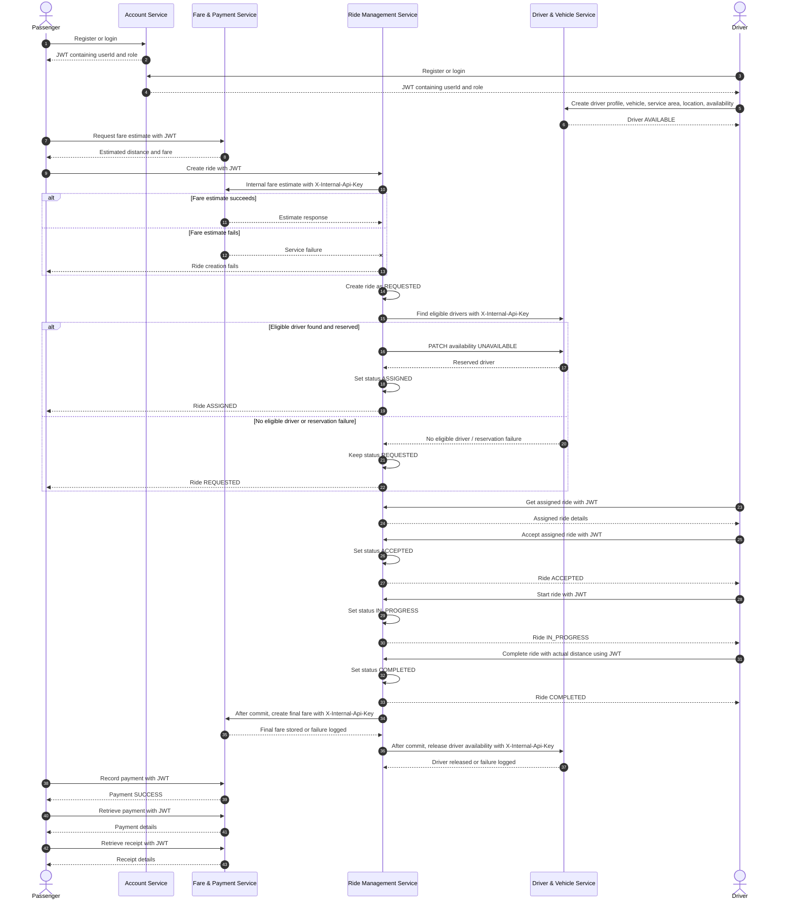

# RideLink Ride Request Sequence Diagram

This sequence shows the final implemented RideLink workflow. It uses the actual Ride Management status names from the merged implementation: `REQUESTED`, `ASSIGNED`, `ACCEPTED`, `IN_PROGRESS`, `COMPLETED`, and `CANCELLED`.



## Implemented Interservice Interactions

Ride -> Driver uses synchronous REST with `X-Internal-Api-Key` on `/internal/drivers/**` for eligible lookup, driver identity resolution, and PATCH availability reservation/release. Public Driver endpoints under `/api/v1/drivers/**` remain JWT/RBAC protected. The Ride Driver client uses Java `HttpClient` / `JdkClientHttpRequestFactory` so PATCH availability calls work correctly.

Ride -> Fare uses synchronous REST with `X-Internal-Api-Key` on `/internal/fares/**`. Fare estimate occurs before ride persistence. Final fare creation occurs after the completed ride commits.

## Ride Lifecycle and Cancellation

```text
REQUESTED -> ASSIGNED -> ACCEPTED -> IN_PROGRESS -> COMPLETED
```

Cancellation is allowed only from `REQUESTED`, `ASSIGNED`, and `ACCEPTED`.

## Failure Behavior

Fare estimate failure prevents successful ride creation. Driver assignment or reservation failure can leave the ride in `REQUESTED`. Ride completion is committed before final-fare and driver-release follow-up calls; those follow-up failures are logged and do not roll back the completed ride.

## Final E2E Evidence

The final live E2E run passed 21/21 checks: 16 positive and 5 negative. It verified Account -> Driver -> Ride -> Fare/Payment end-to-end, including `ASSIGNED`, `ACCEPTED`, `IN_PROGRESS`, `COMPLETED`, final fare creation, payment `SUCCESS`, receipt retrieval, and expected `401`, `403`, and `409` behavior.
